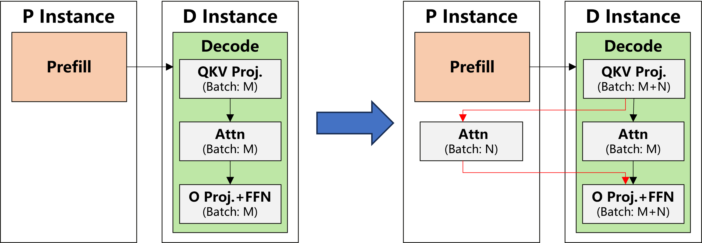

# Adrenaline

| [**Blog**](https://asisys.github.io/projects/2025-07-08-adrenaline/) | [**Paper**](https://arxiv.org/pdf/2503.20552) |

Adrenaline is an attention decoupling and offloading mechanism, designed to boost the resource utilization and performance in LLM serving systems. Based on the PD-disaggregation LLM inference paradigm, Adrenaline disaggregates part of the attention computation in the decoding phase and offloads them to prefill instances. This enhances resource utiliaztion and performance while ensuring compliance with user SLOs.

Adrenaline's advantages stem from the following aspects:

- Improved memory capacity and bandwidth utilization in prefill instances
- Increased decoding batch sizes that enhance compute utilization in decoding instances
- Dynamic offloading scheduling to preserve compliance with user SLOs

<p align="center"></p>
<p align="center"><em>Figure 1. Comparison of original PD disaggregation and Adrenaline (decode batch size: M v.s. M + N ).</em></p>

## Installation

It's recommend to use [uv](https://docs.astral.sh/uv/), a very fast Python environment manager, to create and manage Python environments.

```bash
pip install uv ninja pytest
uv pip install -e .
uv pip install flashinfer-python -i https://flashinfer.ai/whl/cu124/torch2.5/
python adrenaline/setup.py install
```

## Getting Start

1. Setup MPS

    ```bash
    bash adrenaline/scripts/start_mps.sh
    ```

2. Prepare minimal running environment (download dummy model weight, profile runtime data)

    ```bash
    VLLM_ATTENTION_BACKEND=ADRENALINE_FLASHINFER python -m examples.adrenaline.download_model
    bash adrenaline/scripts/profile_attention_bandwidth.sh
    ```

3. Start adrenaline servers (prefill/decode/attention instances)
    - For easier to check the instance's status and output, we use `tmux` to maintain sessions for adrenaline instances, please install `tmux` before start adrenaline servers.
    - You can execute `tmux attach adrenaline` to check the output of the instances.

    ```bash
    bash examples/adrenaline/start_demo_servers.sh
    ```

4. Start clients and send requests to adrenaline servers

    ```bash
    bash examples/adrenaline/start_clients.sh
    ```

5. Stop adrenaline servers and MPS

    ```bash
    bash examples/adrenaline/stop_demo_servers.sh
    bash adrenaline/scripts/stop_mps.sh
    ```

## Evaluation

We list some of the primary evaluation results. Please reference to [evaluation guidance](evaluation/README.md) and check our paper for more details. We evaluate the performance of Adrenaline on A100 80GB SXM and choose [vllm](https://github.com/vllm-project/vllm/pull/8498) as our baseline. Note that, for simplicity, all frameworks turn off specific optimizations like quantization, speculative decoding, multi-step, etc.. By enhancing the resource utilization of the prefill and decode instances, Adrenaline achieves up to **1.35\~1.80x** decode throughput boost compared to vllm.

<p align="center"></p>
<p align="center"><em>Figure 2. The end-to-end evaluation of Llama-3.1 8B using mooncake dataset.</em></p>

<p align="center"></p>
<p align="center"><em>Figure 3. The end-to-end evaluation of Llama-2 13B using mooncake dataset.</em></p>

## Acknowledgments

This project is built upon [vllm](https://github.com/vllm-project/vllm). We extend our gratitude to the developers of vLLM. Besides, as we transitioned from an internal development environment to this open-source platform, the detailed commit history and authorship information could not be preserved. Hence, we are taking this opportunity to formally acknowledge all contributors.

## Citation

If you find this project useful in your research, please consider citing our paper:

```bibtex
@misc{liang2025injectingadrenalinellmserving,
      title={Injecting Adrenaline into LLM Serving: Boosting Resource Utilization and Throughput via Attention Disaggregation}, 
      author={Yunkai Liang and Zhangyu Chen and Pengfei Zuo and Zhi Zhou and Xu Chen and Zhou Yu},
      year={2025},
      eprint={2503.20552},
      archivePrefix={arXiv},
      primaryClass={cs.DC},
      url={https://arxiv.org/abs/2503.20552}, 
}
```
