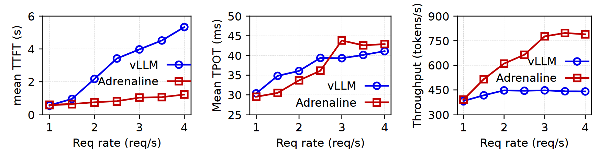
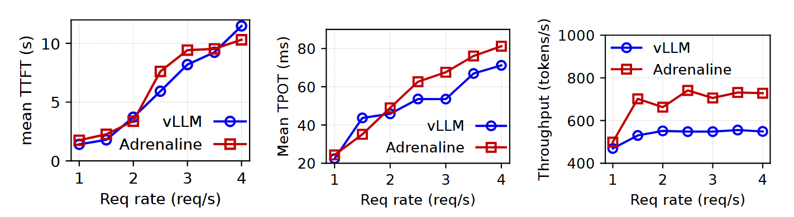

# Evaluation

This folder contains the detailed instructions and necessary scripts to evaluate the Adreanline's performance and reproduce the primary evaluation results.

## Prepare Datasets and Models

1. Prepare Datasets:
    ```bash
    bash evaluation/run/0_prepare_dataset.sh
    ```
2. Prepare Models:
    ```bash
    python -m examples.adrenaline.download_model --model meta-llama/Llama-2-13b-hf
    python -m examples.adrenaline.download_model --model meta-llama/Llama-3.1-8b
    ```

## Evaluate with `Llama-2-13B`

1. Evaluate the performance of vllm (PD disaggregation):
    ```bash
    bash evaluation/run/dataset_performance/mooncake_llama_2_13b_disaggregation_evaluation.sh
    ```
2. Evaluate the performance of Adrenaline:
    ```bash
    bash evaluation/run/dataset_performance/mooncake_llama_2_13b_adrenaline_evaluation.sh
    ```
3. Plot the evaluation results:
    ```bash
    python -m evaluation.plots.dataset_performance.plot_mooncake_llama_2_13b
    ```

It will generate the plots of evaluation results in `evaluation/plots/dataset_performance`.

<p align="center"></p>
<p align="center"><em>Figure 1. The end-to-end evaluation of Llama-2 13B using mooncake dataset.</em></p>

## Evaluate with `Llama-3.1-8B`

1. Evaluate the performance of vllm (PD disaggregation):
    ```bash
    bash evaluation/run/dataset_performance/mooncake_llama_2_13b_disaggregation_evaluation.sh
    ```
2. Evaluate the performance of Adrenaline:
    ```bash
    bash evaluation/run/dataset_performance/mooncake_llama_2_13b_adrenaline_evaluation.sh
    ```
3. Plot the evaluation results:
    ```bash
    python -m evaluation.plots.dataset_performance.plot_mooncake_llama_3_1_8b
    ```

It will generate the plots of evaluation results in `evaluation/plots/dataset_performance`.

<p align="center"></p>
<p align="center"><em>Figure 2. The end-to-end evaluation of Llama-3.1 8 using mooncake dataset.</em></p>
